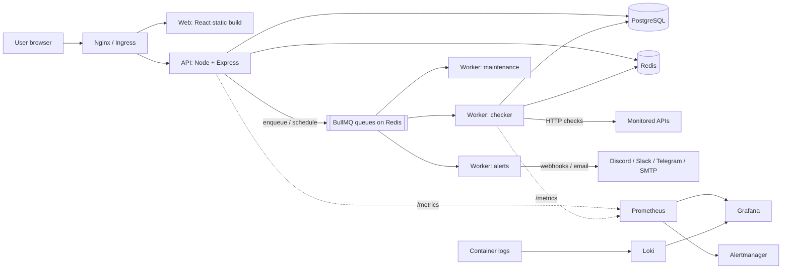

# PulseWatch: API Monitoring Platform (a DevOps learning project)

> "PulseWatch" is a working name. Rename it freely.
> Goal: build a real, useful application, then wrap it in a full professional DevOps workflow, one layer at a time, using only free tools.

---

## Table of contents

1. [Project description](#1-project-description)
2. [Goals and non-goals](#2-goals-and-non-goals)
3. [Features and scope](#3-features-and-scope)
4. [Architecture](#4-architecture)
5. [Tech stack (all free, with alternatives)](#5-tech-stack-all-free-with-alternatives)
6. [Data model](#6-data-model)
7. [API design](#7-api-design)
8. [Queue and worker design](#8-queue-and-worker-design)
9. [Caching design](#9-caching-design)
10. [Metrics, logging and health](#10-metrics-logging-and-health)
11. [Configuration (environment variables and ports)](#11-configuration-environment-variables-and-ports)
12. [Repository structure](#12-repository-structure)
13. [Working agreements](#13-working-agreements)
14. [Roadmap overview](#14-roadmap-overview)
15. [Phases 0 to 17 (step by step)](#15-phases-step-by-step)
16. [Risks and how to handle them](#16-risks-and-how-to-handle-them)
17. [Free-tier caveats](#17-free-tier-caveats)
18. [Glossary of DevOps terms](#18-glossary-of-devops-terms)
19. [Final checklist](#19-final-checklist)

---

## 1. Project description

**PulseWatch** is a web platform that watches APIs and websites and shows their "life": whether they are up, how fast they respond, where they fail, and how they behave over time.

A user signs up, adds the URL of an API endpoint (for example `https://api.example.com/health`), and chooses how often to check it. Background workers call the endpoint on schedule, record the result, and detect outages. When an endpoint fails several times in a row, PulseWatch opens an **incident** and sends an alert (Discord, Slack, Telegram, email, or a webhook). When it recovers, the incident is closed and a recovery alert is sent. A React dashboard shows current status, uptime percentage, response-time charts, error breakdowns, and incident history.

There are two ways to watch an API, and the project covers both:

| Mode | How it works | Answers | Phase |
|---|---|---|---|
| **Outside-in monitoring** (core) | Workers call the API like a user would | Is it up? How fast? What errors? | 1 to 6 |
| **Inside-out usage tracking** (extension) | A small middleware inside the monitored API reports its own traffic | How much is it used? Which endpoints are slow or failing? | 16 |

### Why this project

It naturally needs every piece of a modern backend system, so each DevOps tool you learn has something real to act on:

- **Frontend**: React dashboard
- **Backend API**: Node.js REST API with authentication
- **Database**: PostgreSQL, with time-series style data (check results, rollups, retention)
- **Cache**: Redis (latest status, dashboard stats, rate limiting)
- **Queue and background workers**: BullMQ on Redis (scheduled checks, alerts, maintenance jobs)
- **External API calls**: workers call monitored URLs and alert webhooks
- **Metrics**: the app is itself about metrics, so Prometheus and Grafana feel natural

It is also genuinely useful: you can point it at your other projects, and it is a strong portfolio piece for DevOps, backend, and data engineering roles (time-series modeling, rollups, retention, pipelines).

---

## 2. Goals and non-goals

### Learning goals

- Build a multi-service application (API, workers, database, cache, queue, frontend).
- Learn and apply: Linux, Git workflow, Docker, Docker Compose, GitHub Actions (CI/CD), Terraform, Kubernetes, Helm, Argo CD (GitOps), Prometheus, Grafana, Loki, Trivy, secrets management, load testing, and incident response basics.
- End with a repository that a recruiter can read in five minutes and understand.

### Product goals (MVP)

- Users can register, log in, and manage monitors.
- Monitors are checked automatically at chosen intervals.
- Failures create incidents and send alerts.
- A dashboard shows status, uptime, latency, and errors.

### Non-goals (do not build these, to protect scope)

- Multi-region checking (a stretch idea only)
- Teams, organizations, roles, or billing
- A mobile app
- Complex RBAC or SSO
- Real-time websockets (polling every 15 to 30 seconds is enough; SSE is optional)

---

## 3. Features and scope

### MVP (must have)

1. **Auth**: register, login, JWT-protected routes, hashed passwords.
2. **Monitors**: create, read, update, pause/resume, delete. Fields: name, URL, HTTP method, expected status codes, interval, timeout, failure threshold.
3. **Checks**: scheduled HTTP checks via queue and workers; record status code, latency, error type, and timestamp.
4. **Incidents**: open after N consecutive failures; close on first success.
5. **Alerts**: at least Discord/Slack-style webhook and email or Telegram; test button; no duplicate alerts.
6. **Stats**: uptime %, average and p95 latency, error breakdown, for 24h / 7d / 30d.
7. **Dashboard**: monitor list with live status, monitor detail page with charts, incident list.
8. **Safety**: SSRF protection, input validation, rate limiting, health endpoints.

### Version 2 (after the DevOps phases are done)

- Inside-out SDK (Express middleware) reporting API usage
- Public status page per user
- SSL certificate expiry alerts
- Keyword/JSON-body assertions on responses
- Multi-region checks (run workers in two places)

### Defaults and limits (decided now so nothing is ambiguous later)

| Setting | Value |
|---|---|
| Allowed check intervals | 30 s, 60 s (default), 5 min, 15 min |
| Request timeout | default 10 s, maximum 30 s |
| Failure threshold (consecutive failures before an incident) | default 3 |
| Max monitors per user | 50 (configurable) |
| Raw result retention | 30 days |
| Hourly rollup retention | 13 months |
| Response body | read and discarded, never stored |

Storage sanity check: one monitor at a 60 s interval produces 1,440 rows per day. 20 monitors for 30 days is about 860,000 rows, which is trivial for PostgreSQL.

---

## 4. Architecture



### Components

| Component | Responsibility |
|---|---|
| **web** | React single-page app, served as static files by Nginx |
| **api** | REST API: auth, monitors, stats, incidents, alert channels; enqueues and schedules jobs; exposes `/healthz`, `/readyz`, `/metrics` |
| **worker** | Processes three queues: `checks`, `alerts`, `maintenance`. Same codebase image can run as several replicas |
| **postgres** | Source of truth for all data |
| **redis** | BullMQ queues, cache, rate-limit counters |
| **demo-target** | A deliberately flaky sample API (random errors and slow responses) used to test the platform |
| **prometheus / grafana / loki / alertmanager** | Observability stack for PulseWatch itself |

### Data flow for one check

1. User creates a monitor, so the API saves it in PostgreSQL and registers a **repeating job** for it in the `checks` queue.
2. At each interval, a worker receives a job `{ monitorId }`.
3. The worker loads the monitor config, validates the target with the SSRF guard, performs the HTTP request with a timeout, and measures latency.
4. The worker inserts a row into `check_results` and updates `monitor_state` in PostgreSQL and the "latest" cache in Redis.
5. The state machine evaluates the result: consecutive failures reach the threshold, so an incident opens and an `alerts` job is enqueued. A success after an incident closes it and enqueues a recovery alert.
6. The `alerts` worker sends the notification to each linked channel, with retries and exponential backoff, and records an `alert_events` row.
7. The dashboard polls the API, which serves stats from cache (falling back to PostgreSQL).

---

## 5. Tech stack (all free, with alternatives)

### Application

| Need | Primary choice | Alternatives |
|---|---|---|
| Language | JavaScript (ES modules) on Node.js current LTS | TypeScript (optional upgrade), Go or Python for the worker |
| API framework | Express | Fastify, Hono, NestJS |
| Validation | zod | joi, ajv |
| Database | PostgreSQL | SQLite for very early dev only; Neon or Supabase free tiers if you want hosted |
| DB access | `pg` plus plain SQL migrations (`node-pg-migrate`) | Drizzle, Prisma, Knex |
| Queue | BullMQ on Redis | RabbitMQ, pg-boss (queue on Postgres), Graphile Worker |
| Cache / rate limit | Redis | Valkey (open-source Redis fork), in-memory (dev only) |
| HTTP client (checks) | Node built-in `fetch` (undici) with a custom connect-time DNS lookup | `got`, `axios` |
| Auth | JWT plus argon2 (or bcrypt) | Session cookies, Passport |
| Logging | pino (JSON logs) | winston |
| Metrics library | `prom-client` | OpenTelemetry metrics |
| Frontend | React + Vite + React Router | Next.js, Vue, Svelte |
| Charts | Recharts | Chart.js, uPlot |
| Data fetching | TanStack Query (polling) | plain `fetch` plus `useEffect` |
| Tests | Vitest or Jest, Supertest, Testcontainers (optional) | node:test |
| Linting / formatting | ESLint, Prettier | Biome |

### DevOps

| Need | Primary choice | Alternatives |
|---|---|---|
| Source and CI/CD | GitHub + GitHub Actions | GitLab CI, Codeberg + Woodpecker CI |
| Containers (local) | Docker Engine + Docker Compose | Podman + podman-compose |
| Container registry | GitHub Container Registry (GHCR) | Docker Hub, GitLab registry |
| Free server | Oracle Cloud Always Free VM | Your own PC/old laptop as a home server, AWS/GCP free tier (time-limited) |
| Reverse proxy and HTTPS | Nginx + Let's Encrypt (Certbot) | Caddy (automatic HTTPS), Traefik |
| Free domain/DNS | DuckDNS | Cloudflare DNS (free), a free subdomain service |
| Infrastructure as Code | Terraform | OpenTofu (open-source fork), Pulumi free tier |
| Local Kubernetes | k3d (k3s in Docker) | kind, minikube |
| Server Kubernetes | k3s on a VM | microk8s |
| Packaging | Helm | Kustomize |
| GitOps | Argo CD | Flux CD |
| Metrics / dashboards | Prometheus + Grafana | VictoriaMetrics, Grafana Cloud free tier |
| Alert routing | Alertmanager | Grafana alerting |
| Logs | Loki + Grafana Alloy (successor to Promtail) | OpenSearch, Grafana Cloud free tier |
| Image/IaC scanning | Trivy | Grype, Checkov |
| Secret scanning | gitleaks | GitHub secret scanning (public repos) |
| Secrets in Git | Sealed Secrets or SOPS + age | External Secrets, Vault dev mode |
| Load testing | k6 | Locust, autocannon, vegeta |
| Dependency updates | Dependabot | Renovate |
| Alert destinations | Discord/Slack/Telegram webhooks | Free SMTP tier, ntfy |

---

## 6. Data model

All tables use `uuid` primary keys unless noted, and `timestamptz` for time.

### `users`
`id`, `email` (unique), `password_hash`, `created_at`

### `monitors`
`id`, `user_id` (FK users), `name`, `url`, `method` (GET/HEAD/POST), `expected_status` (text, e.g. `200-299`), `headers` (jsonb, optional), `body` (text, optional), `interval_seconds`, `timeout_ms`, `failure_threshold`, `is_active`, `created_at`, `updated_at`

### `monitor_state` (one row per monitor, written by workers)
`monitor_id` (PK, FK monitors), `current_status` (`unknown` / `up` / `down`), `consecutive_failures`, `last_checked_at`, `last_latency_ms`, `last_status_code`

### `check_results` (the big time-series table)
`id` (bigserial), `monitor_id` (FK), `checked_at`, `success` (boolean), `status_code` (nullable), `latency_ms` (nullable), `error_type` (nullable: `timeout`, `dns`, `connection`, `tls`, `blocked_target`, `unexpected_status`, `other`), `error_message` (nullable, truncated)
Index: `(monitor_id, checked_at DESC)`

### `incidents`
`id`, `monitor_id` (FK), `started_at`, `resolved_at` (nullable), `cause` (text), `last_status_code` (nullable)
Rule: at most one open incident (`resolved_at IS NULL`) per monitor. Enforce with a partial unique index on `monitor_id WHERE resolved_at IS NULL`.

### `alert_channels`
`id`, `user_id` (FK), `type` (`discord`, `slack`, `telegram`, `email`, `webhook`), `name`, `config` (jsonb: URL, token, address), `is_active`, `created_at`

### `monitor_alert_channels` (many-to-many)
`monitor_id` (FK), `channel_id` (FK), primary key on both

### `alert_events` (audit log and dedupe)
`id`, `incident_id` (FK), `channel_id` (FK), `event_type` (`opened` / `resolved`), `sent_at`, `success`, `error_message` (nullable)
Unique on `(incident_id, channel_id, event_type)` so an alert is never sent twice.

### `check_rollups_hourly` (aggregated data)
`monitor_id` (FK), `bucket_start` (hour), `total_checks`, `failed_checks`, `avg_latency_ms`, `p95_latency_ms`, `max_latency_ms`
Primary key `(monitor_id, bucket_start)`.

### Retention and rollup rules

- A maintenance job creates or updates hourly rollups from `check_results`.
- Raw rows older than 30 days are deleted only after their hours have been rolled up.
- Stats for 24 h and 7 d read raw data; the 30 d view reads rollups. This keeps queries fast and gives you a real data-engineering story.
- Optional upgrade: partition `check_results` by month, or use TimescaleDB.

### Secrets note

`alert_channels.config` and `monitors.headers` can contain tokens. Never log them, never return them in full from the API (mask them), and consider encrypting them at rest with an app-level key from the environment.

---

## 7. API design

Base path `/api`. JSON in and out. All routes except register, login, and ops endpoints require `Authorization: Bearer <JWT>`. Every user can only access their own data.

Error format (consistent everywhere):

```json
{ "error": { "code": "VALIDATION_ERROR", "message": "interval_seconds must be one of 30, 60, 300, 900" } }
```

### Auth
| Method | Path | Purpose |
|---|---|---|
| POST | `/api/auth/register` | Create account |
| POST | `/api/auth/login` | Returns a short-lived JWT |
| GET | `/api/auth/me` | Current user |

Refresh tokens are a stretch goal. For the MVP, use a short-lived JWT (for example 1 hour) and log in again.

### Monitors
| Method | Path | Purpose |
|---|---|---|
| GET | `/api/monitors` | List (includes cached latest status) |
| POST | `/api/monitors` | Create (validates URL, registers the repeating job) |
| GET | `/api/monitors/:id` | Detail |
| PATCH | `/api/monitors/:id` | Update fields, including `is_active` to pause/resume (re-syncs the job) |
| DELETE | `/api/monitors/:id` | Delete (removes the job) |
| POST | `/api/monitors/:id/check-now` | Enqueue an immediate check |

### Results, stats, incidents
| Method | Path | Purpose |
|---|---|---|
| GET | `/api/monitors/:id/results?from=&to=&limit=` | Raw check results (paginated) |
| GET | `/api/monitors/:id/stats?range=24h\|7d\|30d` | Uptime %, avg/p95 latency, error breakdown, latency time series |
| GET | `/api/dashboard/summary` | Counts of up/down/paused monitors, overall uptime (cached) |
| GET | `/api/incidents?monitor_id=&status=open\|resolved` | Incident list |

### Alert channels
| Method | Path | Purpose |
|---|---|---|
| GET / POST | `/api/alert-channels` | List / create |
| PATCH / DELETE | `/api/alert-channels/:id` | Update / delete |
| POST | `/api/alert-channels/:id/test` | Send a test message |
| PUT | `/api/monitors/:id/alert-channels` | Set which channels a monitor uses |

### Operational (not behind auth, not exposed publicly)
| Method | Path | Purpose |
|---|---|---|
| GET | `/healthz` | Liveness: the process is running |
| GET | `/readyz` | Readiness: PostgreSQL and Redis reachable |
| GET | `/metrics` | Prometheus metrics; blocked at the public reverse proxy/ingress |

---

## 8. Queue and worker design

### Queues

| Queue | Job data | Produced by | Consumed by |
|---|---|---|---|
| `checks` | `{ monitorId }` | API (scheduler registration, check-now) | Worker |
| `alerts` | `{ incidentId, channelId, eventType }` | Worker (state machine) | Worker |
| `maintenance` | `{ task: 'rollup' \| 'retention' }` | Repeating schedule | Worker |

### Scheduling

- Each active monitor has one repeating schedule in the `checks` queue, keyed by the monitor id and using that monitor's interval. Use BullMQ's repeatable-job feature (newer versions call it job schedulers; check the current BullMQ docs for exact method names).
- Creating, updating, pausing, resuming, or deleting a monitor updates or removes its schedule.
- **Reconciler**: when a worker starts, it compares active monitors in PostgreSQL to schedules in Redis and fixes any difference. This makes the system self-healing if Redis is wiped (you will test exactly this in Phase 15).

### Check execution rules

1. Load monitor config (cache-aside).
2. **SSRF guard** (critical, since users supply URLs):
   - Allow only `http` and `https`.
   - Resolve DNS and block private, loopback, link-local, and cloud metadata ranges (for example `127.0.0.0/8`, `10.0.0.0/8`, `172.16.0.0/12`, `192.168.0.0/16`, `169.254.0.0/16`, and IPv6 equivalents).
   - Validate at **connection time** (custom DNS lookup in the HTTP agent), not only when the monitor is saved, to defeat DNS rebinding.
   - Limit redirects (for example 3) and re-check each hop.
   - Cap the response size read.
   - Exception: hostnames in `SSRF_ALLOWED_HOSTS` (for example `demo-target`), or everything when `ALLOW_PRIVATE_TARGETS=true` in local dev only.
3. Send the request with `AbortSignal.timeout(timeout_ms)`; measure latency; discard the body.
4. Classify the result as success, or as a failure with an `error_type`.
5. Write `check_results`, update `monitor_state`, update Redis "latest" cache.
6. Run the state machine.

### State machine

```
unknown/up --failure--> consecutive_failures + 1
   if consecutive_failures >= failure_threshold and no open incident:
        status = down, open incident, enqueue "opened" alert per channel
down --success--> status = up, consecutive_failures = 0,
        close the open incident, enqueue "resolved" alert per channel
up --success--> consecutive_failures = 0
```

The partial unique index on open incidents and the unique constraint on `alert_events` guarantee no duplicates even if two workers race.

### Reliability settings

- Checks: no retry of a failed job (a failure is a valid result, not a job error); the job fails only on internal errors.
- Alerts: up to 5 attempts, exponential backoff.
- Concurrency: `WORKER_CONCURRENCY` (default 10).
- Keep completed and failed jobs only briefly (BullMQ cleanup options) so Redis does not grow forever.
- Graceful shutdown: on `SIGTERM`, stop taking jobs, finish active ones, then exit (essential for Kubernetes rolling updates).

---

## 9. Caching design

Pattern: **cache-aside** (read cache; on miss read PostgreSQL and fill the cache).

| Key | Value | TTL | Invalidated when |
|---|---|---|---|
| `monitor:{id}:latest` | latest status, latency, time | 2x the monitor interval | Overwritten by each check |
| `monitor:{id}:config` | monitor config used by workers | 5 min | Monitor updated or deleted |
| `stats:{monitorId}:{range}` | computed stats JSON | 60 s | Expires naturally |
| `dashboard:{userId}:summary` | summary JSON | 20 s | Expires naturally |
| `rl:{scope}:{identifier}` | request counter | window length | Window ends |

Rate limiting: a general limit per IP/user, and a much stricter limit on login and register to slow brute-force attacks. Use a Redis-backed limiter so the limit is shared across API replicas.

Rule: **PostgreSQL is the source of truth; the cache can be wiped at any time without data loss.** The app must still work (slower) if Redis is empty.

Mind **cache stampedes** (many requests refilling the same expired key at once): short TTL jitter is enough at this scale.

---

## 10. Metrics, logging and health

### Logging

- JSON logs to stdout (pino). One line per event, with a request id.
- Never log secrets, tokens, passwords, or full alert channel config.
- In containers, always log to stdout/stderr, never to files.

### Prometheus metrics

**API** (`/metrics`):
- `http_requests_total{method,route,status}`
- `http_request_duration_seconds{method,route,status}` (histogram)
- Default Node.js process metrics (memory, CPU, event loop lag)

**Worker** (own metrics endpoint on its own port):
- `pulsewatch_checks_total{result="success|failure"}`
- `pulsewatch_check_duration_seconds` (histogram)
- `pulsewatch_queue_jobs{queue,state}` gauge (waiting, active, delayed, failed)
- `pulsewatch_alerts_sent_total{channel_type,result}`
- `pulsewatch_scheduling_lag_seconds` (how late checks start)
- Default Node.js process metrics

Cardinality rule: never use URLs, user ids, or monitor ids as metric labels. Labels must have a small, fixed set of values.

**Infrastructure exporters** (added in Phase 9): `postgres_exporter`, `redis_exporter`, `node_exporter`, and cAdvisor (container metrics).

### Health endpoints

- `/healthz` returns 200 if the process is alive. It must not check dependencies.
- `/readyz` returns 200 only if PostgreSQL and Redis respond. Kubernetes uses it to decide whether to send traffic.

---

## 11. Configuration (environment variables and ports)

Twelve-factor rule: **all configuration comes from environment variables.** Commit only `.env.example`; never commit real secrets.

### Environment variables

| Variable | Used by | Meaning |
|---|---|---|
| `NODE_ENV` | all | `development`, `test`, `production` |
| `LOG_LEVEL` | all | `info`, `debug`, and so on |
| `DATABASE_URL` | api, worker | PostgreSQL connection string |
| `REDIS_URL` | api, worker | Redis connection string |
| `JWT_SECRET` | api | Signing secret (long, random) |
| `JWT_EXPIRES_IN` | api | For example `1h` |
| `CORS_ORIGIN` | api | Allowed frontend origin |
| `RATE_LIMIT_WINDOW_SECONDS`, `RATE_LIMIT_MAX` | api | General limiter |
| `AUTH_RATE_LIMIT_MAX` | api | Stricter login/register limit |
| `MAX_MONITORS_PER_USER` | api | Default 50 |
| `ENCRYPTION_KEY` | api, worker | Optional key for encrypting channel config |
| `WORKER_CONCURRENCY` | worker | Parallel checks per worker |
| `ALLOW_PRIVATE_TARGETS` | worker, api | `true` only in local dev |
| `SSRF_ALLOWED_HOSTS` | worker, api | Comma list of exempt hostnames (for example `demo-target`) |
| `SMTP_URL` | worker | Optional, for email alerts |
| `VITE_API_BASE_URL` | web | API base path or URL |

### Ports (no two services share a host port)

| Service | Port |
|---|---|
| api | 3000 |
| grafana | 3001 (changed from its default 3000 to avoid clashing with the API) |
| loki | 3100 |
| demo-target | 4000 |
| web (dev, Vite) | 5173 |
| web (container, Nginx) | 8080 |
| worker metrics | 9100 |
| prometheus | 9090 |
| alertmanager | 9093 |
| postgres | 5432 |
| redis | 6379 |
| postgres_exporter | 9187 |
| redis_exporter | 9121 |

---

## 12. Repository structure

A monorepo using npm workspaces.

```
pulsewatch/
├── apps/
│   ├── api/
│   │   ├── src/ (config, routes, services, middleware, db, lib)
│   │   ├── migrations/
│   │   ├── tests/
│   │   └── Dockerfile
│   ├── worker/
│   │   ├── src/ (processors, scheduler, reconciler, alerts)
│   │   ├── tests/
│   │   └── Dockerfile
│   ├── web/
│   │   ├── src/ (pages, components, api client)
│   │   ├── nginx.conf
│   │   └── Dockerfile
│   └── demo-target/            # flaky sample API for testing
│       ├── src/
│       └── Dockerfile
├── packages/
│   └── shared/                 # config loader, logger, db/redis clients, SSRF guard, queue names
├── deploy/
│   ├── compose/                # docker-compose.yml, docker-compose.observability.yml, .env.example
│   ├── observability/          # prometheus.yml, alert rules, grafana dashboards (JSON), loki/alloy config
│   ├── terraform/              # infrastructure as code
│   ├── helm/pulsewatch/        # Helm chart for the app
│   ├── k8s/                    # raw manifests (learning step) and cluster add-ons
│   └── argocd/                 # Argo CD Application manifests
├── scripts/
│   └── loadtest/               # k6 scripts
├── docs/
│   ├── architecture.md
│   ├── decisions/              # architecture decision records (ADRs)
│   ├── runbooks/               # what to do when X breaks
│   └── postmortems/
├── .github/
│   ├── workflows/              # ci.yml, release.yml, security.yml, terraform.yml
│   └── dependabot.yml
├── .env.example
├── .gitignore
├── .dockerignore
├── package.json                # workspaces
├── plan.md
└── README.md
```

Note: because `apps/api` and `apps/worker` import `packages/shared`, Docker builds must use the **repository root as build context** (a common monorepo gotcha you will solve in Phase 7).

---

## 13. Working agreements

Treat this like a team project even though you are solo.

- **Git flow**: short-lived branches, pull request into `main`, even for solo work. `main` is always deployable.
- **Commits**: small, with clear messages (Conventional Commits style, for example `feat(api): add monitor CRUD`).
- **CI must pass** before merging (enforce with branch protection once CI exists).
- **Task tracking**: GitHub Issues and a GitHub Projects board; one issue per task below.
- **Decisions**: write a short ADR in `docs/decisions/` whenever you choose between options (for example "Why BullMQ instead of RabbitMQ").
- **Never commit secrets.** If you do, rotate them immediately; deleting the commit is not enough.
- **Build step by step with help**: you are new to React, so ask for guided, step-by-step help in Phase 5, one concept at a time. Keep targeted changes in your own code style rather than rewrites.
- **Every phase ends with a demo**: run the "Done when" checks, commit, tag (`v0.1.0`, `v0.2.0`, ...).

---

## 14. Roadmap overview

Assumes about 8 to 10 hours per week. Adjust freely; the order matters more than the dates.

| Phase | Name | Weeks | Output |
|---|---|---|---|
| 0 | Environment and repo setup | 1 | Tools installed, repo, workspaces |
| 1 | Backend foundation | 1 to 2 | API with auth and monitor CRUD on PostgreSQL |
| 2 | Queue and checker worker | 3 | Scheduled checks produce results |
| 3 | Incidents and alerts | 4 | Outage detection and notifications |
| 4 | Stats, rollups, caching, rate limiting | 5 | Fast stats API, Redis cache |
| 5 | Frontend (React) | 6 to 7 | Working dashboard |
| 6 | Testing and app hardening | 8 | Tests, health, metrics, graceful shutdown |
| 7 | Docker and Compose | 9 | Whole system via `docker compose up` |
| 8 | CI with GitHub Actions | 10 | Automated test, build, scan, push |
| 9 | Observability (Prometheus, Grafana, Loki) | 11 | Dashboards and alerts for PulseWatch itself |
| 10 | Deploy to a server | 12 | Live on the internet with HTTPS, auto-deploy |
| 11 | Infrastructure as Code (Terraform) | 13 | Server created from code |
| 12 | Kubernetes and Helm | 14 to 15 | App running on a cluster |
| 13 | GitOps with Argo CD | 16 | Git-driven deployments |
| 14 | Security hardening | 17 | Scanning, secrets, least privilege |
| 15 | Reliability: load, chaos, SLOs | 18 | Runbooks and postmortems |
| 16 | Optional extensions | ongoing | SDK, status pages, and more |
| 17 | Documentation and portfolio polish | 19 | README, diagrams, demo |

### Milestones

- **M1 (end of Phase 6)**: a complete, tested app running locally.
- **M2 (end of Phase 8)**: containerized with automated CI.
- **M3 (end of Phase 10)**: live on the internet with automated deployment.
- **M4 (end of Phase 11)**: infrastructure reproducible from code.
- **M5 (end of Phase 13)**: running on Kubernetes with GitOps.
- **M6 (end of Phase 15)**: production-grade: observed, secured, load-tested.

If time is short, **M3 is already a strong portfolio project**; everything after is a bonus.

---

## 15. Phases (step by step)

Each phase lists: tasks, what to learn, and a "Done when" check. Do not start the next phase until the current one is done.

### Phase 0: Environment and repo setup

**Tasks**
- [ ] Update Linux Mint: `sudo apt update && sudo apt upgrade`.
- [ ] Install Git, configure name and email, and create an SSH key for GitHub.
- [ ] Install Node.js current LTS using `nvm`.
- [ ] Install Docker Engine and the Compose plugin using the official Docker docs for Ubuntu (Linux Mint is Ubuntu-based; use the Ubuntu instructions and the matching Ubuntu codename). Add your user to the `docker` group.
- [ ] Install PostgreSQL client tools (`psql`) and `redis-cli` for debugging.
- [ ] Create the GitHub repo `pulsewatch` (public repos get more free CI minutes).
- [ ] Create the monorepo skeleton from section 12 with npm workspaces, `.gitignore`, `.env.example`, and a first README.
- [ ] Add ESLint and Prettier.
- [ ] Create a GitHub Projects board and add one issue per phase.

**Learn**: Git branching, SSH keys, package managers, what a monorepo is.

**Done when**: `docker run hello-world` works, `node -v` works, the repo is pushed to GitHub, and `npm install` works at the root.

### Phase 1: Backend foundation

**Tasks**
- [ ] Run PostgreSQL and Redis locally using a minimal `docker compose` file (only the two services for now).
- [ ] Create `packages/shared` with the config loader (reads and validates env vars), pino logger, and database/Redis client factories.
- [ ] Set up migrations (`node-pg-migrate`) and create the tables for `users` and `monitors`.
- [ ] Build the Express app in `apps/api`: JSON parsing, request id, error-handling middleware with the standard error format, CORS, and security headers (helmet).
- [ ] Implement register, login (argon2 or bcrypt hashing, JWT), and `/api/auth/me`.
- [ ] Implement an auth middleware.
- [ ] Implement monitor CRUD with zod validation, checking that each user can only access their own monitors and that limits (max monitors, allowed intervals) are enforced.
- [ ] Add the SSRF URL checks that can be done at save time (scheme and obviously private literal IPs). The connection-time check comes in Phase 2.
- [ ] Add `/healthz` and `/readyz`.
- [ ] Test every endpoint manually with curl or a REST client.

**Learn**: REST design, JWT, password hashing, SQL migrations, input validation, twelve-factor config.

**Done when**: you can register, log in, and create, list, update, and delete monitors via the API, and another user cannot see your monitors.

### Phase 2: Queue and checker worker

**Tasks**
- [ ] Build `apps/demo-target`: endpoints such as `/ok`, `/slow?ms=`, `/error?rate=0.3`, `/status/:code`, and `/flaky` (random failures and latency). You will monitor this constantly.
- [ ] Add migrations for `monitor_state` and `check_results`.
- [ ] In `packages/shared`, implement the SSRF guard (section 8) with unit tests, including DNS rebinding and redirect cases.
- [ ] Create the BullMQ `checks` queue. In the API, register, update, and remove the repeating schedule when monitors change (create, update, pause, resume, delete) and add `check-now`.
- [ ] Build `apps/worker`: the checker processor (section 8), result classification, writes to `check_results` and `monitor_state`.
- [ ] Add the reconciler that syncs schedules at worker startup.
- [ ] Add worker graceful shutdown.
- [ ] Run the demo-target locally, add monitors for it, and watch results accumulate in PostgreSQL.

**Learn**: queues, repeatable jobs, concurrency, timeouts and AbortController, DNS and SSRF, idempotency.

**Done when**: monitors pointing at the demo target are checked automatically at their intervals; timeouts, 500s, and DNS failures are classified correctly; private addresses are rejected (unless explicitly allowed); pausing a monitor stops its checks; restarting the worker (or flushing Redis) restores all schedules.

### Phase 3: Incidents and alerts

**Tasks**
- [ ] Add migrations for `incidents`, `alert_channels`, `monitor_alert_channels`, `alert_events`, including the partial unique index and unique constraint described in section 6.
- [ ] Implement the state machine inside the checker (in a database transaction).
- [ ] Create the `alerts` queue and its processor with retries and exponential backoff.
- [ ] Implement alert senders for Discord/Slack-style webhooks and one more (Telegram or email).
- [ ] Implement alert channel CRUD, the test endpoint, and linking channels to monitors.
- [ ] Mask secrets when returning channel config; never log them.
- [ ] Add the incidents API.
- [ ] Test: make the demo target fail and verify one alert on open and one on recovery, with no duplicates.

**Learn**: state machines, transactions, idempotent consumers, exponential backoff, webhooks.

**Done when**: an outage creates exactly one incident and one alert per channel; recovery closes it with one recovery alert; killing a worker mid-alert does not cause duplicates.

### Phase 4: Stats, rollups, caching, rate limiting

**Tasks**
- [ ] Add the `check_rollups_hourly` migration.
- [ ] Create the `maintenance` queue with a repeating hourly rollup job and a daily retention job (delete raw rows older than 30 days that are already rolled up; drop rollups older than 13 months).
- [ ] Implement stats queries: uptime %, average and p95 latency (use `percentile_cont`), error breakdown by `error_type`, and time series. Use raw data for 24h and 7d, rollups for 30d.
- [ ] Implement `/api/monitors/:id/stats`, `/api/dashboard/summary`, and `/api/monitors/:id/results` with pagination.
- [ ] Add Redis caching exactly as in section 9, including the "latest status" cache written by workers.
- [ ] Add Redis-backed rate limiting, stricter on login and register.
- [ ] Compare response times with and without cache (note them for your README).
- [ ] Verify the API still works with an empty Redis.

**Learn**: cache-aside, TTL and invalidation, SQL aggregates and percentiles, time-series rollups, retention policies.

**Done when**: stats are correct (cross-check one against manual SQL), cached calls are visibly faster, rate limits trigger, and the system works after `FLUSHALL`.

### Phase 5: Frontend (React)

You are new to React, so go slowly. Build in small, working slices and ask for step-by-step guidance on each.

**Tasks**
- [ ] Understand and set up Vite with React in `apps/web`; learn the project layout and how the dev server proxies `/api` to port 3000.
- [ ] Learn core React ideas as needed: components, props, state, effects, and hooks.
- [ ] Add routing: login, register, dashboard, monitor detail, incidents, alert channels.
- [ ] Build an API client module that attaches the JWT and handles 401 (redirect to login).
- [ ] Login and register pages.
- [ ] Dashboard: list of monitors with status badge, latest latency, and uptime; summary tiles; polling every 15 to 30 seconds (TanStack Query).
- [ ] Add/edit monitor form with validation matching the API.
- [ ] Monitor detail page: latency chart (Recharts), uptime for 24h / 7d / 30d, error breakdown, recent results, incident list, pause/resume, check-now.
- [ ] Alert channels page with a test button.
- [ ] Empty, loading, and error states on every page.

**Learn**: React fundamentals, client-side routing, data fetching and caching, charting.

**Done when**: you can do everything in the MVP feature list from the browser, and the dashboard updates itself as the demo target flips between up and down.

### Phase 6: Testing and app hardening

**Tasks**
- [ ] Unit tests: SSRF guard, state machine, interval and validation rules, stats calculations.
- [ ] Integration tests: API with a real PostgreSQL and Redis (use containers or Testcontainers), auth and ownership checks, monitor CRUD, scheduler sync.
- [ ] Worker tests: successful check, timeout, bad status, blocked target, alert dedupe.
- [ ] Basic frontend tests (a few key components) or one end-to-end smoke test.
- [ ] Add Prometheus instrumentation to the API and worker (section 10), exposing `/metrics`.
- [ ] Make sure logs are structured JSON with request ids and no secrets.
- [ ] Verify graceful shutdown for API and worker (`SIGTERM`).
- [ ] Add `npm run lint`, `npm test`, and `npm run build` scripts at the root so CI can call them.
- [ ] Tag `v0.1.0`.

**Learn**: testing pyramid, test isolation, instrumentation, observability basics.

**Done when (Milestone M1)**: `npm test` passes from a clean checkout and the full app works locally end to end.

### Phase 7: Docker and Compose

**Tasks**
- [ ] Write a `.dockerignore` (exclude `node_modules`, `.git`, `.env`, build output).
- [ ] Write production Dockerfiles for api, worker, demo-target, and web using **multi-stage builds**; use a slim Debian-based Node image (avoid Alpine if a native module such as argon2 causes trouble); install only production dependencies in the final stage; run as a **non-root user**; use the repo root as build context for monorepo packages.
- [ ] The web image builds the React app, then serves it with Nginx (SPA fallback to `index.html`, proxy `/api` to the API, **do not** proxy `/metrics`).
- [ ] Create `deploy/compose/docker-compose.yml` with: api, worker, web, demo-target, postgres, redis. Use named volumes for PostgreSQL and Redis data, a private network, health checks, `depends_on` with health conditions, and restart policies.
- [ ] Run migrations as a separate one-shot service or command (not inside the API start-up) and learn why.
- [ ] Load config from an env file; commit `.env.example` only.
- [ ] Add a dev override file with bind mounts and hot reload for development.
- [ ] Check image sizes and layer caching; try to shrink images.
- [ ] Document one-command startup: `docker compose up --build`.

**Learn**: images vs containers, layers and caching, multi-stage builds, networks, volumes, health checks, why containers should be non-root.

**Done when**: from a fresh clone, `docker compose up --build` brings up the entire system; data survives `docker compose down` and `up` again (volumes); containers run as non-root.

### Phase 8: CI with GitHub Actions

**Tasks**
- [ ] Create `.github/workflows/ci.yml`, triggered on pull requests and pushes to `main`.
- [ ] Jobs: install with dependency caching, lint, test (PostgreSQL and Redis as service containers), and build.
- [ ] Add a job that builds the Docker images with Buildx and layer caching.
- [ ] Scan images with Trivy and fail on high or critical vulnerabilities that have fixes (decide a sensible policy and document it).
- [ ] On pushes to `main`: push images to GHCR, tagged with the commit SHA (and `latest` only as a convenience, never as the deploy reference).
- [ ] Add `permissions:` blocks that grant the minimum token permissions per job; keep secrets in GitHub Actions secrets.
- [ ] Enable branch protection: require the CI checks to pass and require pull requests.
- [ ] Add Dependabot for npm, Docker, and GitHub Actions.
- [ ] Add gitleaks (secret scanning) to the workflow.
- [ ] Add a CI status badge to the README.

**Learn**: CI vs CD, workflows, jobs, steps, runners, caching, artifacts, secrets, least-privilege tokens, image tagging strategy.

**Done when (Milestone M2)**: opening a pull request runs all checks; merging to `main` publishes scanned images to GHCR with SHA tags; a deliberately failing test blocks the merge.

### Phase 9: Observability (Prometheus, Grafana, Loki)

**Tasks**
- [ ] Add `deploy/compose/docker-compose.observability.yml` with Prometheus, Grafana (host port 3001), Alertmanager, Loki, Grafana Alloy, and the exporters (postgres, redis, node, cAdvisor).
- [ ] Configure Prometheus scrape jobs for the API, worker, and exporters.
- [ ] Provision the Grafana data sources and dashboards **from files in Git** (no manual clicking that can be lost).
- [ ] Build dashboards: API request rate, error rate and latency (RED method); worker check throughput, success ratio, check duration, queue depth, scheduling lag; PostgreSQL and Redis health; container CPU and memory.
- [ ] Write Prometheus alert rules: API 5xx rate high, queue backlog growing, scheduling lag high, worker down, PostgreSQL or Redis down.
- [ ] Route alerts through Alertmanager to Discord or Telegram.
- [ ] Ship container logs to Loki with Alloy and add a logs panel with a request-id search.
- [ ] Trigger problems on purpose (stop the worker, flood the queue) and confirm dashboards and alerts react.

**Learn**: metrics vs logs vs traces, scraping, PromQL basics, histograms and percentiles, the RED and USE methods, alert rules and routing, dashboards as code.

**Done when**: you can answer "is PulseWatch healthy?" from one Grafana dashboard, and stopping a service sends you an alert within a couple of minutes.

### Phase 10: Deploy to a server

First do it **manually** so you understand every step; Terraform automates it in Phase 11.

**Tasks**
- [ ] Get a Linux server: Oracle Cloud Always Free VM, or your own spare machine/old laptop. If cloud signup fails, use the home server option; the learning value is the same.
- [ ] Secure the server: SSH key-only login, disable password login, firewall (`ufw` plus the cloud security list allowing only 22, 80, 443), `fail2ban`, automatic security updates.
- [ ] Install Docker and Compose on the server.
- [ ] Get a free domain or subdomain (for example DuckDNS) and point it at the server.
- [ ] Put a reverse proxy in front (Nginx plus Certbot, or Caddy for automatic HTTPS) and enable HTTPS with Let's Encrypt. Block `/metrics` and the observability ports from the public internet (access Grafana through an SSH tunnel or an authenticated, restricted route).
- [ ] Copy `docker-compose.yml` and the production env file (kept only on the server, never in Git), pull the images from GHCR, and start the stack.
- [ ] Set production values: strong `JWT_SECRET`, `ALLOW_PRIVATE_TARGETS=false`, `SSRF_ALLOWED_HOSTS=demo-target`.
- [ ] Add database backups: a scheduled `pg_dump` to a safe location, and **test a restore**.
- [ ] Add a CD workflow: after CI succeeds on `main`, a job connects over SSH (key in GitHub secrets), pulls the new SHA-tagged images, and runs `docker compose up -d`. Include a health check and an automatic rollback to the previous tag if it fails.
- [ ] If you cannot expose the machine publicly, use a free tunnel (for example Cloudflare Tunnel) instead of opening ports.
- [ ] Tag `v0.2.0`.

**Learn**: Linux server administration, SSH, firewalls, reverse proxies, TLS certificates, DNS, backups and restores, deployment and rollback.

**Done when (Milestone M3)**: PulseWatch is reachable over HTTPS, a merge to `main` deploys automatically, a bad deploy rolls back, and you have restored a backup at least once.

### Phase 11: Infrastructure as Code (Terraform)

**Tasks**
- [ ] Install Terraform (or OpenTofu).
- [ ] Write Terraform for the server infrastructure: network, subnet, firewall rules (22, 80, 443), compute instance, public IP, and a `cloud-init` script that installs Docker and prepares the host.
- [ ] Use variables, outputs, and a sensible file layout; never hard-code secrets.
- [ ] Keep state safe: do **not** commit state files; use a remote backend or at minimum keep local state out of Git and back it up.
- [ ] Practice the cycle `terraform fmt`, `validate`, `plan`, `apply`, then **`destroy` and re-apply** to prove the server is reproducible.
- [ ] Add a CI workflow that runs `fmt -check`, `validate`, and a Trivy/Checkov scan on pull requests, and shows the `plan`.
- [ ] If you have no cloud account: use the Terraform Docker provider to create the networks and containers on your machine, so you still learn the workflow (providers, state, plan/apply, variables, modules).
- [ ] Optional: split into a reusable module.

**Learn**: declarative infrastructure, providers, state, drift, plan vs apply, modules, why IaC beats clicking in a console.

**Done when (Milestone M4)**: you can destroy the environment and recreate a working server from code in minutes, and the infrastructure code is reviewed through pull requests.

### Phase 12: Kubernetes and Helm

**Tasks**
- [ ] Create a local cluster with k3d (or kind); learn `kubectl` basics.
- [ ] Make images available to the cluster (push to GHCR with an image pull secret, or import locally).
- [ ] Write **raw manifests first** to learn the objects: Namespace, Deployment, Service, ConfigMap, Secret for api, worker, web, and demo-target; Postgres and Redis as StatefulSets with PersistentVolumeClaims (note that production would normally use managed or operator-run databases).
- [ ] Add an Ingress for the web and API (block `/metrics` externally).
- [ ] Add liveness probes (`/healthz`) and readiness probes (`/readyz`), plus resource requests and limits for every container.
- [ ] Run migrations as a Kubernetes **Job** before the API starts (Helm hook later).
- [ ] Practice rolling updates, rollbacks (`kubectl rollout undo`), and scaling workers to many replicas while watching queue depth in Grafana.
- [ ] Add a HorizontalPodAutoscaler for the API (needs metrics-server). Stretch: scale workers on queue length with KEDA.
- [ ] Add a PodDisruptionBudget and set `terminationGracePeriodSeconds` so graceful shutdown completes.
- [ ] Convert the manifests into a **Helm chart** (`deploy/helm/pulsewatch`) with `values.yaml` plus `values-dev.yaml` / `values-prod.yaml`, templates, helpers, and a migration hook.
- [ ] Install the community kube-prometheus-stack chart for monitoring and add ServiceMonitors for api and worker (check that the chart you pick is still maintained).
- [ ] Run `helm lint` and `helm template` in CI.
- [ ] Optional: run the same chart on k3s on your server.

**Learn**: pods, deployments, replica sets, services, ingress, config and secrets, probes, requests and limits, StatefulSets and volumes, Jobs, autoscaling, Helm templating, rolling updates.

**Done when**: `helm install` brings up the entire system on the cluster; killing a pod causes automatic recovery; scaling workers visibly increases check throughput; a rolling update causes zero failed checks.

### Phase 13: GitOps with Argo CD

**Tasks**
- [ ] Install Argo CD in the cluster.
- [ ] Create an Argo CD `Application` for the Helm chart (`deploy/argocd/`), with automated sync, **self-heal**, and **prune**.
- [ ] Decide how image versions are promoted: CI opens a pull request (or commits) that updates the image tag in `values-*.yaml`; merging that change is the deployment. Optionally try Argo CD Image Updater.
- [ ] Set up two environments (`dev` and `prod` namespaces or clusters) driven by separate values files; promote dev to prod by pull request.
- [ ] Keep secrets safe in Git with Sealed Secrets or SOPS + age; never store plain Secrets in the repo.
- [ ] Demonstrate self-healing: change something in the cluster by hand and watch Argo CD revert it.
- [ ] Demonstrate rollback: revert a commit and watch the cluster follow.
- [ ] Update `release.yml` so the old SSH deploy is replaced (or kept only for the plain-VM path).

**Learn**: GitOps principles, desired vs actual state, drift detection, declarative promotion, secrets in Git, environment promotion.

**Done when (Milestone M5)**: **merging to `main` results in a new version running in the cluster with no manual commands**, and manual changes to the cluster are reverted automatically.

### Phase 14: Security hardening

**Tasks**
- [ ] Trivy in CI: image scans, filesystem scan, Terraform and Kubernetes manifest (config) scans, with documented policy.
- [ ] Generate an SBOM for images (Trivy or Syft) and attach it to releases.
- [ ] Verify containers: non-root, read-only root filesystem where possible, drop Linux capabilities, `allowPrivilegeEscalation: false`, seccomp default.
- [ ] Kubernetes: NetworkPolicies (only the API and workers may reach the database and Redis; deny by default), a dedicated ServiceAccount per component with minimal RBAC, and no secrets in plain environment files committed anywhere.
- [ ] Application: security headers, strict CORS, tight rate limits, input validation everywhere, SSRF tests, dependency audit, and secret masking in logs.
- [ ] Rotate `JWT_SECRET` as an exercise and document the procedure.
- [ ] Protect `/metrics`, Grafana, and Argo CD with authentication and keep them off the public internet.
- [ ] Pin GitHub Actions to specific versions (or commit SHAs for third-party actions).
- [ ] Write `SECURITY.md` and a short threat model (what could go wrong and what stops it).

**Learn**: supply-chain security, least privilege, defense in depth, NetworkPolicies, RBAC, secrets management, SBOMs.

**Done when**: security scans run automatically with a clear policy, the SSRF tests pass, a pod cannot reach what it should not, and no secrets exist in Git history (verify with gitleaks).

### Phase 15: Reliability, load testing, chaos, and SLOs

**Tasks**
- [ ] Define SLOs for PulseWatch itself, for example: API availability 99%; dashboard API p95 under 500 ms; checks start within 10 s of schedule 99% of the time. Build a Grafana panel for each.
- [ ] Write k6 load tests (many monitors, many dashboard users) and record where it breaks and why (CPU, database, Redis, worker concurrency).
- [ ] Optimize based on evidence (indexes, cache TTLs, concurrency settings, resource limits) and re-test.
- [ ] Run chaos experiments, one at a time, and record the result of each: kill an API pod; kill a worker mid-job; stop Redis (does it recover and reconcile schedules?); stop PostgreSQL; make the demo target slow or unreachable; fill the queue.
- [ ] Write a **runbook** in `docs/runbooks/` for each alert ("what it means, how to check, how to fix").
- [ ] Write at least one **postmortem** for a real failure you caused, using the template: impact, timeline, root cause, what went well, action items.
- [ ] Tag `v1.0.0`.

**Learn**: SLI, SLO, error budgets, load testing, capacity planning, failure modes, runbooks, blameless postmortems.

**Done when (Milestone M6)**: you can show graphs from a load test, explain the bottleneck you found and fixed, and show how the system behaved during each chaos experiment.

### Phase 16: Optional extensions (pick any)

- [ ] **Inside-out usage tracking**: publish a tiny Express middleware package that reports request counts, status codes, and latency per route to PulseWatch (API keys per project, `api_keys` table, ingestion endpoint with batching and rate limits, and a usage dashboard).
- [ ] Public status page per user.
- [ ] SSL certificate expiry checks and alerts.
- [ ] Response assertions (keyword or JSON path).
- [ ] Multi-region checking by running workers in a second location.
- [ ] OpenTelemetry tracing with Tempo or Jaeger.
- [ ] Blue/green or canary deployment with Argo Rollouts.
- [ ] Multi-arch image builds (amd64 and arm64).
- [ ] Cost and capacity report for a hypothetical production deployment.

### Phase 17: Documentation and portfolio polish

**Tasks**
- [ ] README with: one-paragraph pitch, screenshots or a short demo GIF, architecture diagram, feature list, tech stack, quick start (`docker compose up`), deployment overview, and links to docs.
- [ ] `docs/architecture.md` explaining components, data flow, and key design decisions.
- [ ] Complete the ADRs, runbooks, and postmortem.
- [ ] Add a "DevOps pipeline" diagram: push, CI, scan, image, Argo CD, cluster, Grafana.
- [ ] A short "what I learned" and "what I would do differently" section.
- [ ] Clean the repo: remove dead code, make sure all scripts run from a fresh clone.
- [ ] Prepare 4 to 5 resume bullets with numbers (for example "scaled workers to N replicas processing M checks per minute", "reduced dashboard latency from X ms to Y ms with Redis caching").
- [ ] Optional: write a blog post or record a 3-minute walkthrough.

**Done when**: a stranger can understand, run, and be impressed by the project from the README alone.

---

## 16. Risks and how to handle them

| Risk | Mitigation |
|---|---|
| Scope creep | Stick to the MVP; extra ideas go into Phase 16 only |
| Getting stuck on React | Keep the UI plain; use one component library only if needed; ask for guided steps |
| SSRF security hole | Implement the guard in Phase 2 with tests; never disable it in production |
| Cloud signup fails (card issues) | Use a home server, k3s locally, or tunnels; learning value stays the same |
| Free tier limits or changes | Check current limits before relying on them; keep everything runnable locally |
| Accidentally committing secrets | `.gitignore`, `.env.example`, gitleaks in CI, rotate immediately if it happens |
| Redis data loss | Treat Redis as rebuildable; reconciler restores schedules |
| Resource limits on a small VM | Set container resource limits; run observability locally or reduce retention if memory is tight |
| Burnout from too many tools | Pause at each milestone; M3 is already a strong project |

---

## 17. Free-tier caveats

Free offers change often. Before you depend on any of these, verify the current terms:

- Oracle Cloud Always Free resources and signup requirements
- GitHub Actions free minutes (differ for public and private repositories) and GHCR storage
- Neon or Supabase free-tier limits (if you use them)
- Grafana Cloud free-tier limits (if you use it)
- AWS/GCP/Azure free tiers (time-limited or credit-based; managed Kubernetes is generally **not** free)

Everything in this plan can be run for free on your own machine (Docker Compose, k3d, Argo CD, Prometheus, Grafana, Loki, Terraform with the Docker provider).

---

## 18. Glossary of DevOps terms

| Term | Meaning |
|---|---|
| **CI (Continuous Integration)** | Automatically building and testing every change |
| **CD (Continuous Delivery/Deployment)** | Automatically releasing tested changes |
| **GitHub Actions** | GitHub's built-in automation for CI/CD (workflows run on runners) |
| **Container** | A packaged process with its dependencies, isolated from the host |
| **Image** | The read-only template a container starts from |
| **Registry** | A server that stores images (GHCR, Docker Hub) |
| **Docker Compose** | Defines and runs multi-container apps from one file |
| **IaC (Infrastructure as Code)** | Describing servers and networks in code |
| **Terraform / OpenTofu** | Tools that create infrastructure from IaC files |
| **State (Terraform)** | A record of what Terraform has created |
| **Orchestration** | Automatically running, healing, and scaling containers |
| **Kubernetes (K8s)** | The standard container orchestrator |
| **Pod** | The smallest unit in Kubernetes: one or more containers |
| **Deployment** | Keeps a desired number of identical pods running |
| **Service** | A stable network address for a set of pods |
| **Ingress** | Routes outside HTTP traffic to Services |
| **ConfigMap / Secret** | Configuration and sensitive values for pods |
| **StatefulSet / PVC** | Pods with stable identity and persistent storage |
| **Probe (liveness/readiness)** | Health checks Kubernetes uses to restart pods or route traffic |
| **HPA** | Automatically adds or removes pods based on load |
| **Helm / chart** | A package manager and templating system for Kubernetes |
| **GitOps** | Git is the single source of truth; a tool keeps the cluster matching it |
| **Argo CD** | A GitOps tool that syncs Git to Kubernetes |
| **Drift** | When the real system differs from what the code says |
| **Observability** | Understanding a system from its metrics, logs, and traces |
| **Metric** | A number over time (requests per second) |
| **Prometheus / PromQL** | Metrics database and its query language |
| **Grafana** | Dashboard and visualization tool |
| **Loki** | A log storage system designed to work with Grafana |
| **Alertmanager** | Groups, routes, and sends Prometheus alerts |
| **SLI / SLO** | A measured quality (like p95 latency) and the target you promise for it |
| **Error budget** | How much failure the SLO allows |
| **RED / USE methods** | Rate, Errors, Duration for services; Utilization, Saturation, Errors for resources |
| **SSRF** | Tricking a server into requesting internal or unintended addresses |
| **SBOM** | A list of all components inside an image |
| **Least privilege** | Giving each component only the access it needs |
| **Runbook** | A step-by-step guide for handling a specific alert or failure |
| **Postmortem** | A blameless write-up of an incident and its lessons |
| **Chaos experiment** | Deliberately breaking something to see how the system copes |

---

## 19. Final checklist

- [ ] Phases 0 to 6: full app working locally with tests (M1)
- [ ] Phases 7 to 8: containers and CI (M2)
- [ ] Phase 9: observability stack with alerts
- [ ] Phase 10: live on HTTPS with auto-deploy and tested backups (M3)
- [ ] Phase 11: server created from Terraform (M4)
- [ ] Phases 12 to 13: Kubernetes plus Argo CD GitOps (M5)
- [ ] Phase 14: security scans, least privilege, no secrets in Git
- [ ] Phase 15: SLOs, load test results, chaos results, runbooks, postmortem (M6)
- [ ] Phase 17: README, diagrams, resume bullets
- [ ] Optional: Phase 16 extensions
